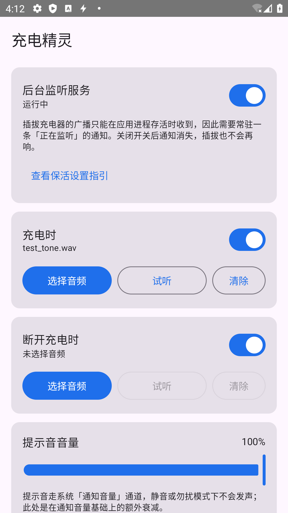
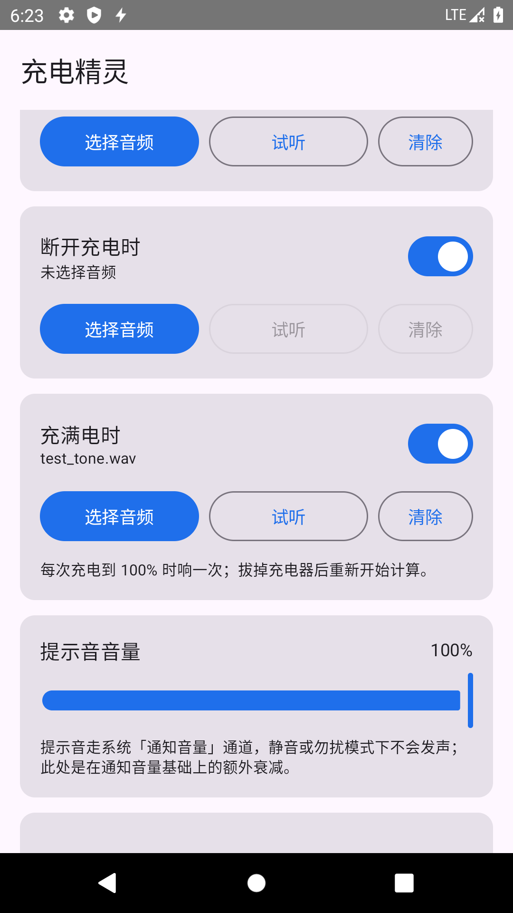
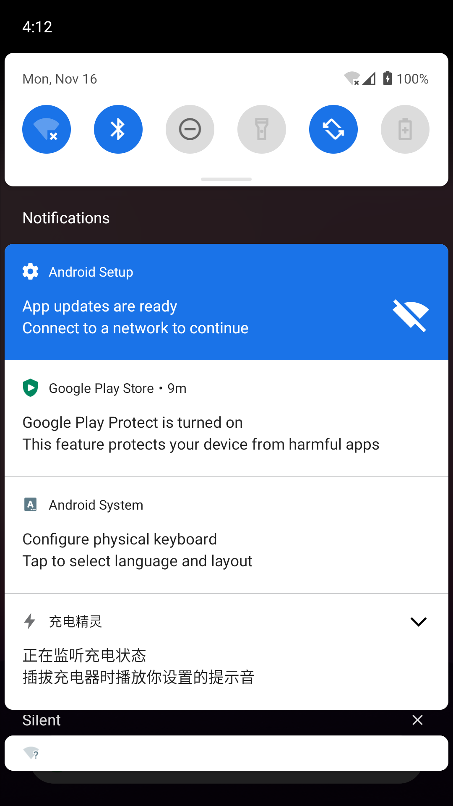

# 充电精灵 ChargeTone

插拔充电器时播放自定义提示音的 Android 应用。为一加 / OPPO（ColorOS）机型设计，纯本地运行、无网络权限、无广告。

> 第三方应用无法替换 ColorOS 系统内置的充电音效，本应用是在系统音效之外**额外播放**你选定的音频。建议先在「设置 → 声音与振动」里关闭系统自带的充电提示音，避免两条声音叠加。

## 功能特性

- **插拔检测**：接入充电器、拔出充电器分别触发，可区分有线 AC / USB / 无线充电
- **充满提醒**：充电到 100% 时再响一次（每个充电周期仅一次，拔出后重新计算）
- **三音效槽位**：充电音、断开音、充满音各自独立设置、独立开关
- **任意音频**：通过系统文件选择器（SAF）选择本地音频，自动复制到应用私有目录，原文件删除或移动不影响使用
- **试听与音量**：随时试听，音量滑块在系统通知音量基础上再做衰减
- **去重防抖**：同一状态变化只响一次，1.2 秒内的抖动丢弃
- **开机自恢复**：重启后自动恢复监听；被系统回收后按 `START_STICKY` 重建服务
- **静音策略**：走系统通知音量通道，静音 / 勿扰模式下自动不发声

## 截图

| 主界面 | 充满电设置 | 常驻通知 |
|---|---|---|
|  |  |  |

## 为什么必须有常驻通知

`ACTION_POWER_CONNECTED` / `ACTION_POWER_DISCONNECTED` 自 Android 8.0 起属于**受限制的隐式广播**，不在官方豁免清单内（见[隐式广播例外情况](https://developer.android.com/guide/components/broadcast-exceptions)）。标注接收器会被系统直接丢弃，因此只能由存活进程中的**动态注册接收器**监听，而让进程存活只能依赖前台服务——代价就是那条「正在监听」的通知。

实现细节、实测对照实验和验证记录见 [docs/技术方案.md](docs/技术方案.md)。

## 安装

从 [Releases](https://github.com/Congratu1ate/Charging_Genie/releases) 下载 `ChargeTone-v0.2.0-debug.apk` 安装。

- 最低支持 Android 8.0（API 26），当前 `targetSdk 34`
- 首批验证机型：一加 Ace 2 Pro（PJA110）/ ColorOS 16 / Android 16
- debug 签名，仅适合个人侧载使用

## 使用步骤

1. 打开应用，开启顶部「**后台监听服务**」开关，允许通知权限
2. 在「充电时」「断开充电时」「充满电时」三张卡片里点「选择音频」，各自挑一个音效（可先点「试听」）
3. 拔插充电器验证；充满提醒会在电量到 100% 时响一次

### ColorOS 保活设置（重要）

ColorOS 默认会清理后台，建议一次性设置好：

- 设置 → 应用 → 充电精灵 → **电池** → 选择「不限制」
- 手机管家 → 应用管理 → **自启动** → 允许充电精灵
- 最近任务列表里给充电精灵**加锁**
- 设置 → 声音与振动 → 关闭系统自带的充电提示音（避免重复）

> 实测：缺少「不限制」时，ColorOS 的 Hans 冻结器会直接冻结本应用进程
> （`OplusHansManager freeze uid`），此时任何插拔广播都收不到。

## 自行构建

```bash
# 需要 JDK 17 与 Android SDK（compileSdk 34 / build-tools 34）
# 首次构建前在项目根目录创建 local.properties，写入自己的 SDK 路径：
#   sdk.dir=C\:\\Android\\Sdk

./gradlew :app:assembleDebug        # 产物 app/build/outputs/apk/debug/app-debug.apk
./gradlew :app:testDebugUnitTest    # 状态机单元测试
./gradlew :app:installDebug         # 安装到已连接的设备
```

真机冒烟验证脚本（安装 + 授权 + 开启服务 + 校验状态）：

```powershell
.\scripts\device-test.ps1
```

## 项目结构

```
app/src/main/java/com/chargetone/app/
├── ChargeToneApp.kt            Application
├── AppGraph.kt                 极简依赖容器
├── audio/PlaybackEngine.kt     MediaPlayer 播放、通知通道、短唤醒锁
├── data/                       设置（DataStore）、音效文件、事件日志
├── power/                      动态监听器、事件处理、状态去重
├── service/                    前台服务、开机恢复、运行状态
└── ui/                         Compose 界面与主题
```

技术栈：Kotlin 2.0 · Jetpack Compose · DataStore · MediaPlayer · AGP 8.5 · Gradle 8.7

## 已知限制

- 必须有常驻通知，这是系统对受限制广播的约束，无法隐藏
- 静音 / 勿扰模式不发声（走通知音量通道）
- 开启「电池保护 / 限充 80%」时电量不到 100%，充满提醒不会响
- 重启后**未解锁**前不响应
- 1.2 秒内的连续插拔会被防抖丢弃
- 不修改系统充电音效，也不承诺覆盖所有机型的省电策略

## 文档

- [技术方案](docs/技术方案.md)：架构、隐式广播限制的实测对照、真机验证记录
- [项目立项书](OPPO自定义充电提示音App项目立项书.md)

## 说明

个人自用项目，与 OPPO / 一加官方无关。仅供学习与个人设备使用。
